# Daniel Miguel Tejedor

### Aerospace Engineering · Software Development · Open Source

**Engineering-minded developer building useful software, exploring complex systems and turning ideas into working products.**

 

---

## Hello, I'm Daniel

I'm an **Aerospace Engineering student at the University of León, Spain**, with a deep interest in open-source software, computational engineering and thoughtful product design.

I build across disciplines: desktop applications, operating systems, engineering tools, automation and infrastructure. What interests me most is how the parts of a complex system fit together — and how to turn that complexity into something people genuinely enjoy using.

I founded **[Nodalia](https://github.com/getnodalia)** as a home for independent open-source products, from Linux and native apps to engineering software and local-first AI.

I care about **clean architecture, efficiency, interoperability, verification and long-term maintainability**. Good engineering and good design should reinforce each other.

## What I'm building

<table>
<tr><td width="50%" valign="top">

### [Nodalix OS](https://github.com/getnodalia/nodalix-os)

A Linux desktop focused on integration, performance and a cohesive native experience.

`Linux` `GNOME` `Systems`

</td><td width="50%" valign="top">

### [Vortia](https://github.com/getnodalia/vortia)

Open computational engineering tools, with a particular interest in fluid dynamics.

`CFD` `Simulation` `Engineering`

</td></tr>
<tr><td width="50%" valign="top">

### [Lumbre](https://github.com/getnodalia/lumbre)

Resource-aware, private and local-first AI for everyday assistance.

`Rust` `AI` `Privacy`

</td><td width="50%" valign="top">

### [Vinilo](https://github.com/getnodalia/vinilo)

A carefully designed native music application and experience.

`Desktop` `Music` `UX`

</td></tr>
<tr><td width="50%" valign="top">

### [Lienzo](https://github.com/getnodalia/lienzo)

Open creative software for image editing and professional workflows.

`Graphics` `Creative tools`

</td><td width="50%" valign="top">

### [Studium](https://github.com/danielmigueltejedor/studium)

Structured academic materials supported by research and verifiable sources.

`Python` `LaTeX` `Education`

</td></tr>
</table>

<a href="https://github.com/orgs/getnodalia/repositories">Explore Nodalia projects →</a>

## Technical interests

| Area | Focus |
| :--- | :--- |
| **Software engineering** | Rust, C++, Python, TypeScript, architecture, testing and performance |
| **Desktop & systems** | Linux, GNOME, Wayland, native interfaces and cross-platform tools |
| **Infrastructure** | Containers, networking, self-hosting, automation and interoperability |
| **Aerospace engineering** | Fluid mechanics, aerodynamics, numerical methods and simulation |

**Languages**

**Tools & platforms**

## How I approach engineering

**Understand first.** Learn the system and its constraints before changing it.

**Design for change.** Prefer clear boundaries and maintainable solutions over short-term shortcuts.

**Measure what matters.** Use profiling, tests and benchmarks rather than assumptions.

**Build for people.** Reliability, speed and usability are all part of technical quality.

**Keep learning.** Every project is an opportunity to challenge assumptions and improve.

## Open source & collaboration

I enjoy exploring established projects, contributing improvements and building tools that make complex ideas more accessible. Issues, thoughtful feedback and contributions are welcome.

---

**Build with purpose. Understand the details. Keep improving.**

[Website](https://danielmigueltejedor.com) · [Nodalia](https://getnodalia.com) · [GitHub](https://github.com/danielmigueltejedor)

